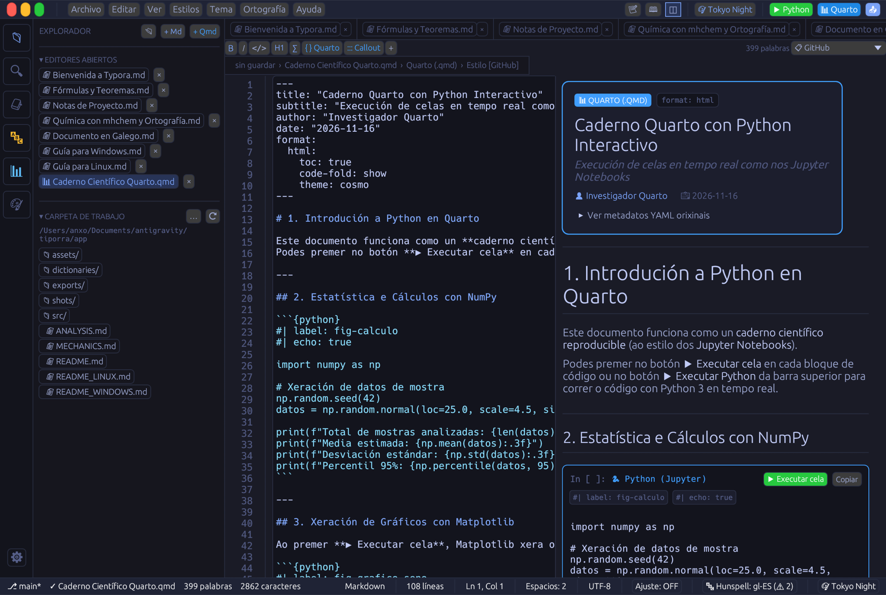
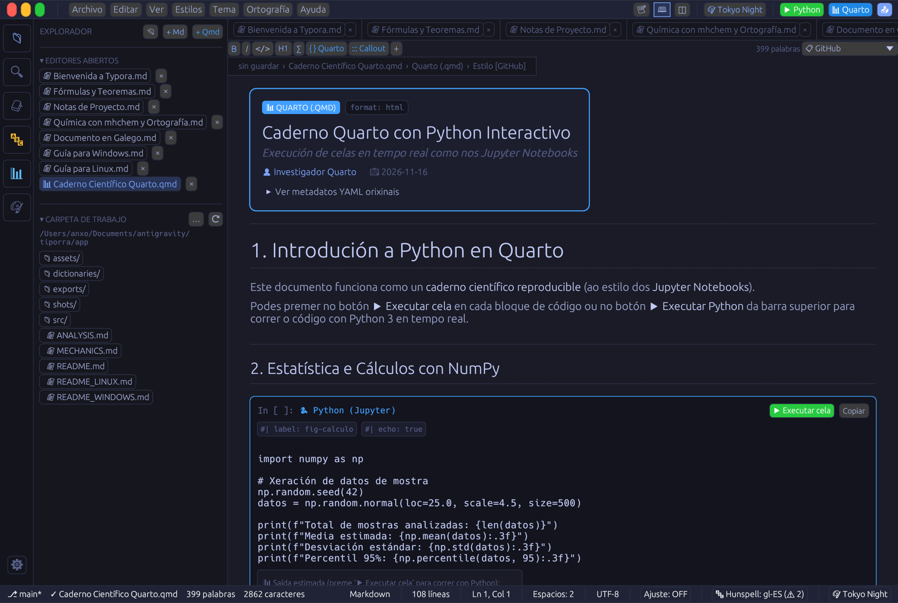
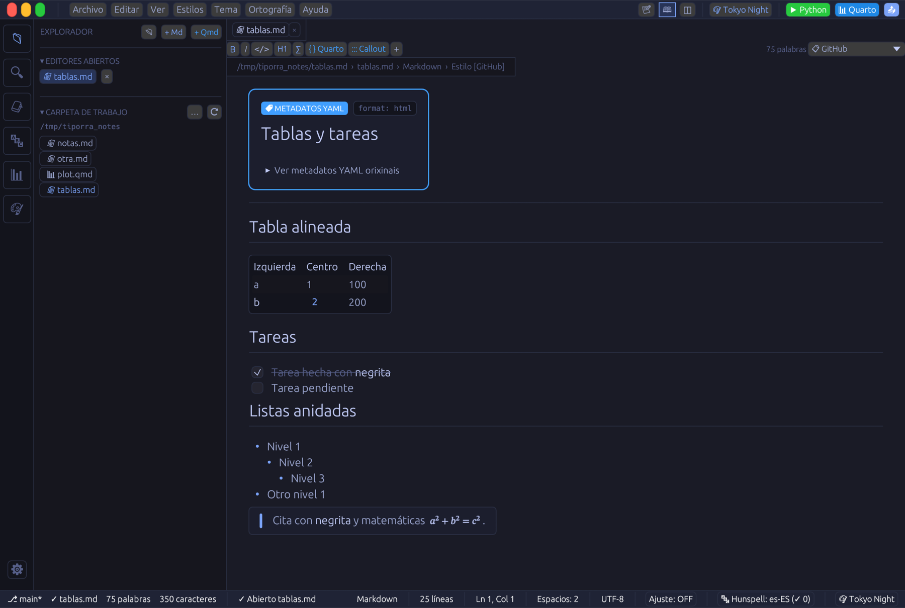
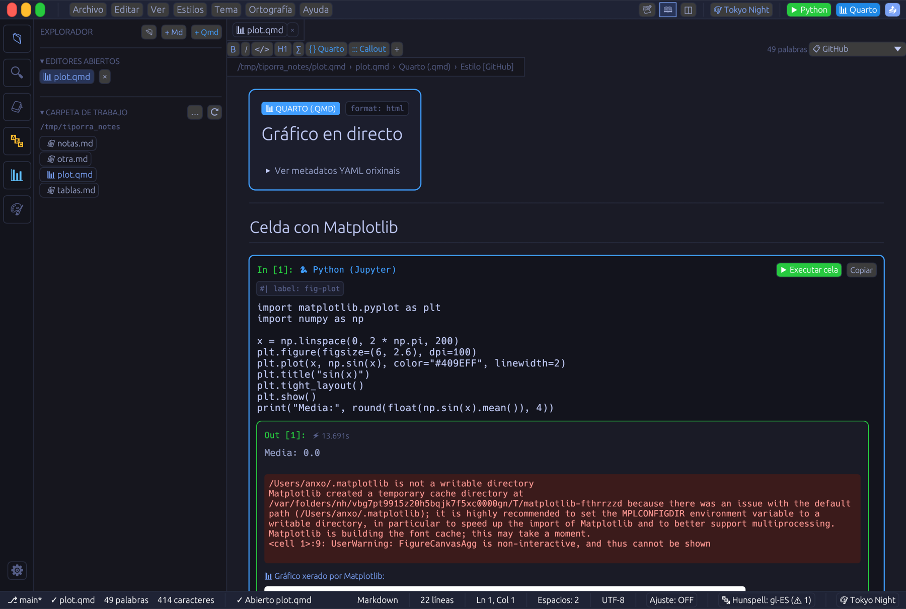
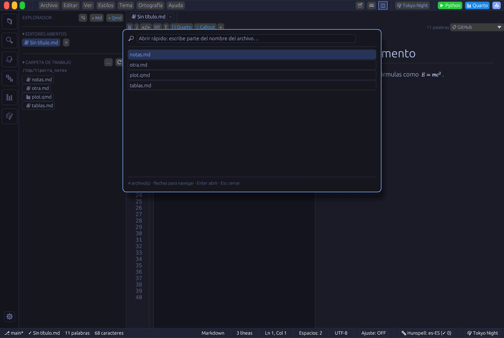
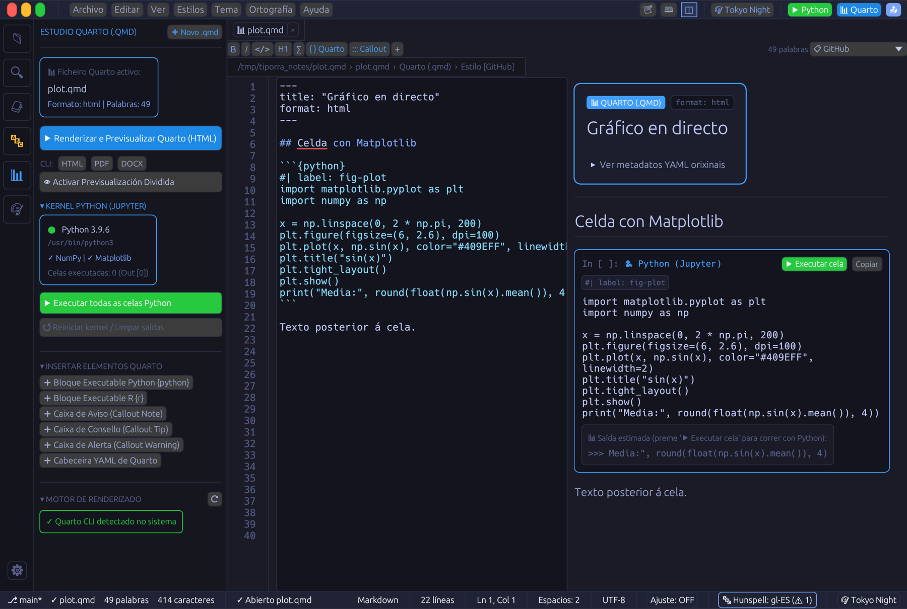

# Tigorra — editor de Markdown y Quarto

[](https://github.com/anxosanchez/tigorra/releases/latest)
[](https://anxosanchez.github.io/tigorra/)

Editor de escritorio nativo (Rust + egui) para **Markdown** y **Quarto (`.qmd`)**, con vista previa
renderizada, KaTeX/mhchem, corrector ortográfico y ejecución de celdas Python.
Proyecto personal inspirado en Typora; no está afiliado a Typora ni a Positron.



## Descargar y ejecutar

Los binarios para macOS (arm64/x86_64), Linux (x86_64) y Windows (x86_64) se publican en
**[Releases](https://github.com/anxosanchez/tigorra/releases/latest)** → descarga el archivo de tu
sistema, descomprímelo y ejecuta `tigorra` (o `Tigorra.exe`).

Desde el código fuente:

```bash
git clone https://github.com/anxosanchez/tigorra.git
cd tigorra
cargo run --release
cargo run --release -- notas.md
```

> **¿Versión web?** Tigorra es una aplicación nativa: necesita acceso al sistema de archivos,
> procesos de Python y al CLI de Quarto para funcionar. GitHub Pages aloja la página del proyecto y
> Releases los binarios; una demo en el navegador exigiría un port a WebAssembly con esas funciones
> desactivadas (ver *Limitaciones*).

## Características

- **Archivos reales**: abrir, guardar, guardar como, guardar todo, recientes, carpeta de trabajo y
  selector de archivos propio (sin dependencias nativas). **Abrir rápido (⌘P)** para saltar a
  cualquier `.md/.qmd` del árbol de trabajo.
- **Deshacer de verdad**: la negrita, el reemplazo global, las correcciones ortográficas y las
  casillas de tareas entran en la pila de deshacer (⌘Z / ⇧⌘Z), igual que lo escrito a mano.
- **Vista previa fiel**: párrafos ajustados, encabezados, tablas con alineación, listas anidadas,
  listas de tareas interactivas, citas, bloques de código, imágenes locales, enlaces clicables y
  fórmulas en línea/bloque.
- **Quarto**: portada YAML, callouts (`::: {.callout-*}`), chunks `{python}`/`{r}` con opciones `#|`,
  render nativo y **Quarto CLI** con salida a HTML, PDF y DOCX (documento real, respetando
  `_quarto.yml` y extensiones).
- **Python persistente**: kernel en segundo plano con estado compartido entre celdas, salida en vivo,
  figuras de Matplotlib inline, cola de ejecución, timeout, reinicio y **botón de interrupción
  (SIGINT)** que detiene una celda sin perder las variables.
- **Corrector Hunspell**: español, gallego e inglés empaquetados; detección de idioma por documento,
  subrayado en el editor, sugerencias, diccionario personal y corrección conservadora.
- **Exportación**: HTML autocontenido y PDF 1.4 (con acentos reales) usando hojas de estilo tipo
  Typora, más PDF/DOCX vía Quarto CLI cuando está disponible.
- **Fuentes incluidas**: DejaVuSans y NotoSansSymbols2 como respaldo para que ✓ ✗ ● ◉ ⚠ ⌘ ⇧ ⏱ ⏹
  se vean igual en macOS, Linux y Windows (sin depender de fuentes del sistema).
- **Interfaz**: barra de actividad, explorador de carpeta, esquema clicable, buscador con recuento,
  7 paletas de color, 5 hojas de estilo y barra de estado con Ln/Col reales.
- **Multiplataforma**: macOS (arm64/x86_64), Linux (x86_64) y Windows (x86_64), con binarios
  publicados desde GitHub Actions en cada etiqueta `v*`.

| Vista previa | Tablas y tareas | Python + Matplotlib |
|---|---|---|
|  |  |  |

| Abrir rápido (⌘P) | Estudio Quarto |
|---|---|
|  |  |

## Uso

```bash
cargo run --release                          # abre con los documentos de ejemplo
cargo run --release -- notas.md              # abre un archivo concreto
cargo run --release -- --folder ~/notas      # abre una carpeta de trabajo
cargo run --release -- --view preview arch.qmd
```

Opciones:

| Opción | Descripción |
|---|---|
| `ARCHIVO.md` / `ARCHIVO.qmd` | Documento inicial |
| `--folder <dir>` | Carpeta del explorador |
| `--view source\|split\|preview` | Vista inicial |
| `--new` | Empieza con un documento vacío |
| `--screenshot <png>` | Captura la ventana y sale (pruebas) |
| `-h`, `--help` | Ayuda |

### Atajos

| Atajo | Acción |
|---|---|
| `⌘/Ctrl + S` | Guardar |
| `⌘/Ctrl + Shift + S` | Guardar como… |
| `⌘/Ctrl + O` | Abrir archivo… |
| `⌘/Ctrl + P` | Abrir rápido (buscar documento por nombre) |
| `⌘/Ctrl + N` / `Shift + N` | Nuevo Markdown / Nuevo Quarto |
| `⌘/Ctrl + F` | Buscar y reemplazar |
| `⌘/Ctrl + B` / `I` | Negrita / cursiva (envuelve la selección) |
| `⌘/Ctrl + W` | Cerrar pestaña |
| `⌘/Ctrl + Z` / `Shift + Z` | Deshacer / rehacer (escritura y acciones de formato) |

## Requisitos

- Rust 1.75+ (probado con 1.100).
- Opcional: **Quarto CLI** (`quarto --version`) para el render real y la exportación a PDF/DOCX
  (el PDF necesita además una distribución de LaTeX; Quarto puede instalarla con `quarto install tinytex`).
- Opcional: **Python 3** con NumPy/Matplotlib para las celdas ejecutables. La app recorre todos los
  intérpretes del sistema y prefiere el que tiene la pila científica instalada (la ruta elegida se
  muestra en el panel Quarto).

## Estructura

```
src/
  main.rs        estado de la app, paneles, menús, diálogos, editor
  documents.rs   documento y gestor de pestañas
  files.rs       lectura/escritura, carpetas, preferencias, selector
  markdown.rs    render de vista previa, tokenizador en línea, imágenes
  quarto.rs      frontmatter, callouts, chunks, kernel Python, render
  math.rs        KaTeX/mhchem a texturas
  export.rs      HTML y PDF con hojas de estilo Typora
  spellcheck.rs  Hunspell, idioma, sugerencias, layouter del editor
  theme.rs       paletas de color y fuentes de símbolos
assets/fonts/    DejaVuSans + NotoSansSymbols2 (con sus licencias)
```

## Pruebas

```bash
cargo test          # 51 tests
cargo build --release
```

CI y releases automatizados (macOS, Linux y Windows) están preparados en `.github/workflows/`; se
activarán al publicar el proyecto con permiso para modificar flujos de trabajo. Mientras tanto,
compila desde el código fuente o descarga lo que haya en Releases.

Capturas automáticas (útil en CI):

```bash
TIPPORA_UI_TEST=picker       ./target/release/tigorra --screenshot /tmp/picker.png
TIPPORA_UI_TEST=quick-open   ./target/release/tigorra --screenshot /tmp/quick.png
TIPPORA_UI_TEST=quarto-panel ./target/release/tigorra --screenshot /tmp/panel.png
TIPPORA_UI_TEST=run-python   ./target/release/tigorra --view preview --screenshot /tmp/run.png doc.qmd
TIPPORA_UI_TEST=glyphs       ./target/release/tigorra --screenshot /tmp/fonts.png
```

> `--screenshot` necesita un servidor gráfico (macOS, X11/Wayland o Windows). En CI sin pantalla,
> usa `xvfb-run` en Linux.

## Limitaciones conocidas

- El renderizador Markdown es propio y por líneas: no implementa todo CommonMark (notas al pie,
  tablas sin cabecera, HTML inline, atributos `{#id}`).
- La vista es «editor + previa»; no es WYSIWYG puro como Typora.
- La ejecución de Python es ejecución de código arbitrario: no la uses con documentos de terceros.
- El historial de deshacer usa instantáneas completas del texto (máx. 100); en documentos de más de
  1,5 MB las acciones de formato no generan punto de deshacer para no disparar la memoria.
- Idiomas CJK (chino, japonés, coreano) no tienen fuente incluida: se verán como cuadros hasta añadir
  una fuente CJK.
- `rustfmt`/`clippy` no están instalados en el entorno de este repositorio; se recomiendan en CI.

### Acerca de la versión web

No hay demo en el navegador por ahora. La app usa el sistema de archivos, `std::process::Command`
(Python y Quarto) y ventanas nativas de egui; un port a WebAssembly requeriría sustituir esas piezas
por APIs del navegador (subir/descargar archivos) y desactivar Python/Quarto. Es un trabajo aparte,
no un flag de compilación.

## Licencia

El código todavía no declara una licencia. Si quieres que otros puedan reutilizarlo, añade un
`LICENSE` (por ejemplo MIT o Apache-2.0) — las fuentes incluidas ya traen las suyas en
`assets/fonts/`.

Ver [`ANALYSIS.md`](ANALYSIS.md) para el análisis completo, los hallazgos corregidos y la hoja de ruta.
